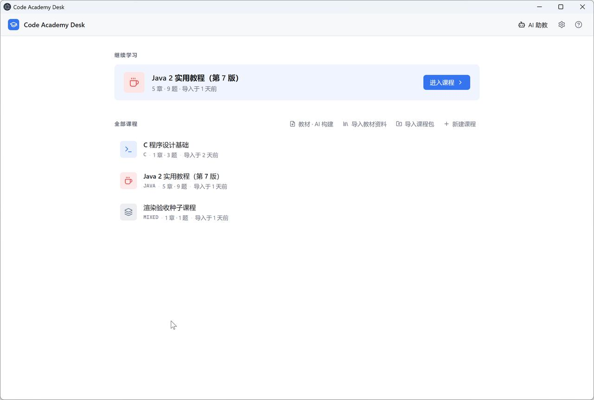
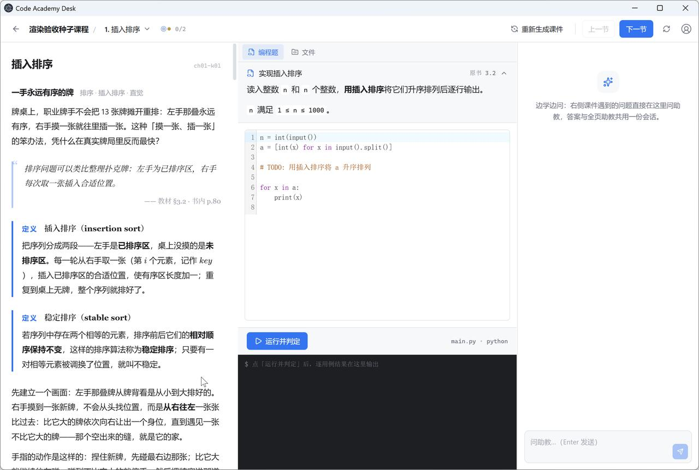
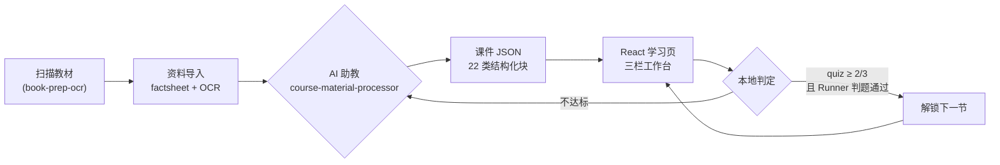
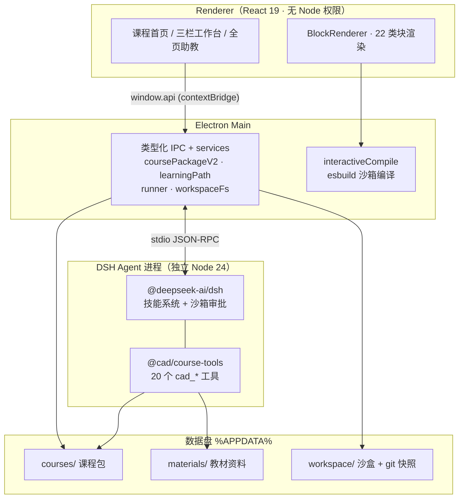
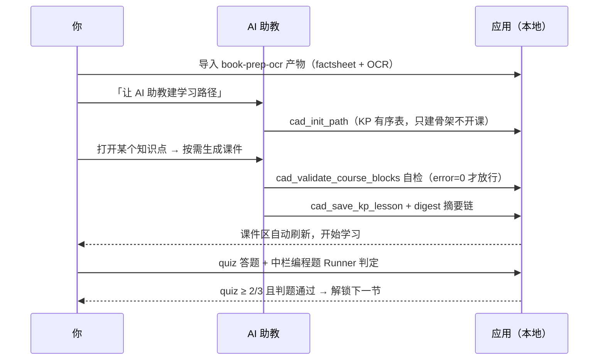

<div align="center">


[](LICENSE)


**教材驱动的桌面编程学习工作台**
把一本扫描版教材，变成可交互、可判题、按知识点渐进解锁的课程。

[快速开始](#-快速开始) · [界面](#-界面) · [核心闭环](#-核心闭环) · [架构](#-架构) · [建课工作流](#-怎么用一本教材建课) · [示例课件](#-示例课件)

</div>

---

## ✨ 界面

<table>
  <tr>
    <td width="50%"></td>
    <td width="50%"></td>
  </tr>
  <tr>
    <td align="center"><sub><b>课程首页</b> —— 继续学习 / 导入导出 / 进度条</sub></td>
    <td align="center"><sub><b>三栏学习工作台</b> —— 左课件正文 · 中代码与判题 · 右 AI 助教</sub></td>
  </tr>
</table>

左栏是课件正文（概念、定义、带页码的教材引用、随堂小测）；中栏是代码区——题面卡 + CodeMirror + 终端风判定面板，右栏是常驻 AI 助教。**顶部工具栏即课程目录**：小节下拉、进度点、上一节/下一节、一键重新生成课件。

## 🧭 核心闭环

学习闭环里只有「生成课件」这一步消耗 AI，其余全部本地执行：



- **AI 负责生产、React 负责渲染**：AI 只产结构化 JSON（text/concept/theorem/anim/interactive…22 类块），样式与交互全在渲染层——改版式零 AI 消耗，课件可校验、可导入导出。
- **页码铁律**：凡标注来源于教材的块必须带页码引用，教材没有的内容不得发明；机检（schema + 容量硬标准）+ 技能发出前自检双道关。
- **本地判题**：python / c / javascript 三档位 Runner，stdin-stdout 逐测试判定，超时杀树——做题不花一分钱 API。

## 🏗 架构



- **interactive 沙箱**：AI 写的 TSX 组件经主进程 esbuild 编译，跑在 `cad-i://` 协议 iframe（opaque origin）里，import 白名单 12 桥，源码级预扫描 + 产物兜底检查双道安全门。
- **Agent 权限**：只读 / 标准（workspace-write + 审批）/ 自由三档位，直通 DSH 原生沙箱；学习状态的写操作（开始/完成/跳过）**故意不暴露给 AI**——判定权在应用。
- **落盘推送**：AI 保存课件（`cad_save_kp_lesson`）成功即推送 `lesson:updated`，课件区自动刷新，不需要手动重选。

## 🚀 快速开始

```bash
npm install          # 首次安装（Electron 二进制走 .npmrc 的 npmmirror 镜像）
npm run dev          # 开发模式
npm run typecheck    # 主进程 + 渲染进程双 tsconfig
npm run test         # vitest，137 用例（全部零 AI 消耗）
npm run dist         # electron-builder 出 NSIS 安装包 + 便携 exe
```

改了 `src/course-tools/` 后需要 `npm run build:plugin`；改了沙箱白名单库后 `npm run build:bridge`。

**配置 AI Key**：应用内右上角 ⚙ → 填写 DeepSeek API Key（存本机 `%APPDATA%\code-academy-desk\agent-settings.json`，掩码显示，永不进代码/日志/仓库）。**没有 Key 也能用**：导入现成课程包学习，只有生成/重新生成课件需要 AI。

## 📖 怎么用一本教材建课



**不满意就重生**：顶部「重新生成课件」（带确认）→ AI 重生成 → 落盘推送自动更新课件区。

## 📦 示例课件

仓库自带一个合成课程（22 类课件块全覆盖 + 编程题，零版权内容）——首页「导入课程」选择 [`examples/render-smoke.zip`](examples/render-smoke.zip) 即可体验完整闭环，源文件在 [`examples/render-smoke/`](examples/README.md)，也可 `node scripts/seed-render-smoke.cjs` 直接写入本机数据盘。

## 🗂 目录结构

```
src/
  main/         主进程（IPC 注册 + services/ 服务层）
  preload/      contextBridge 暴露 window.api
  shared/       主/渲共享契约（IPC 类型 + zod schema：22 块/课程包/学习路径）
  renderer/src/ React 渲染层（页面/三栏工作台/blocks 渲染管线）
  course-tools/ @cad/course-tools DSH 插件（20 个 cad_* 工具）
resources/
  skills/course-material-processor/   课件生成技能（质量标准/块目录/可视化指南）
  dsh-runtime/                        DSH vendor（克隆后需自备，见注意事项）
docs/           架构图 / 截图 / banner
tests/          vitest 15 文件 137 用例（零 AI 消耗）
examples/       示例课件（render-smoke）
design/         设计稿（pen 源 + 首页双屏）
```

## 🔒 安全模型

<details>
<summary>展开查看沙箱与权限设计</summary>

- **interactive 块**（AI 生成的 TSX 组件）：主进程 esbuild 编译 → `cad-i://` 协议 iframe，opaque origin 摸不到宿主；import 白名单 12 桥（react/motion/echarts/konva/xyflow/matter/three/mafs/fs/system/agent/controls）；编译前源码级 import 预扫描 + 产物兜底检查。
- **文件桥只读**：沙箱能读的文件路径在主进程强制限定（manifest/path/progress/chapters/exercises 文本 ≤2MB）。
- **Agent 审批**：DSH 原生 `approval/request` 桥接原生对话框；权限档位变更即重启 Agent 进程。
- **敏感信息**：API Key 只存本机 `%APPDATA%`，渲染层永远拿不到明文（只回掩码）。

</details>

## ⚠️ 已知注意事项

<details>
<summary>展开查看环境要求与已知坑</summary>

- **DSH Runtime vendor**（git 忽略，克隆后需自备）：`cd resources/dsh-runtime && npm install --ignore-scripts --no-audit --no-fund`（禁 `--omit=optional`）；`node24/node.exe` 从 npmmirror 下载 v24 win-x64 zip 提取；最后 `npm run build:plugin`。缺它时应用其余功能可用，仅 AI 生成/对话不可用。
- **本机工具链**：python 在 PATH（判题用）；C 档位需 gcc（MinGW-w64），缺则对应档位报可读错误。
- **better-sqlite3** 需 VS Build Tools；当前索引用 JSON 文件替代，量级无压力。
- 未代码签名：首次运行 SmartScreen 提示选「仍要运行」。
- electron-vite dev 对 main 进程改动不总热重启——改 `src/main/` 后手动重启 dev。

</details>

## 📄 开源协议

本项目以 [AGPL-3.0](LICENSE) 协议开源：任何修改版（包括把它做成闭源云服务/SaaS）都必须以同协议开源。项目作者自身的商业使用（闭源、收费、云服务）不受本协议约束——如果你想在商用场景下获得 AGPL 之外的授权，请联系仓库所有者。

## 📍 状态

- 学习闭环（建课骨架 → 按需生成课件 → 三栏工作台学习 → 判题 → 渐进解锁）已全部打通，2026-11-12 全功能实机验收 12/12 通过。
- 进行中：真 REPL 终端、发布线（vendor 裁剪/签名/自动更新）。
- 路线图明细见 [`AI_HANDOVER.md`](AI_HANDOVER.md) §12，按时间线的运行日志见 [`PROJECT_HANDOVER.md`](PROJECT_HANDOVER.md)，架构图另见 [`docs/architecture.html`](docs/architecture.html)。
